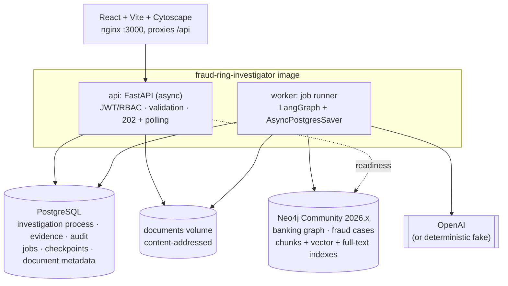
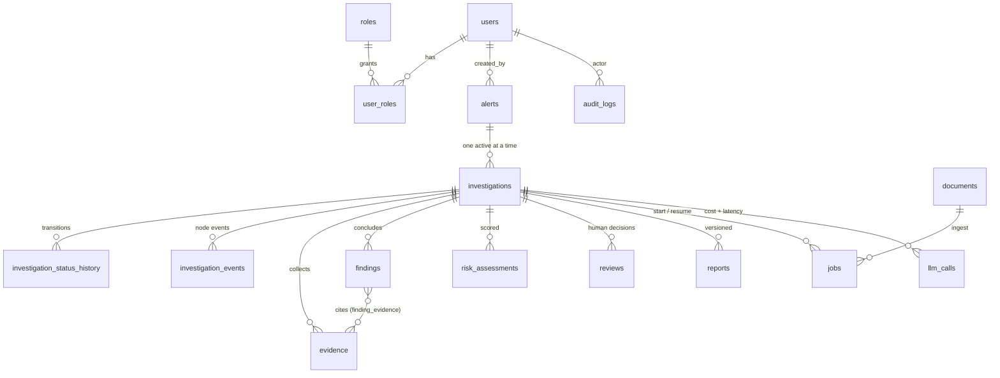
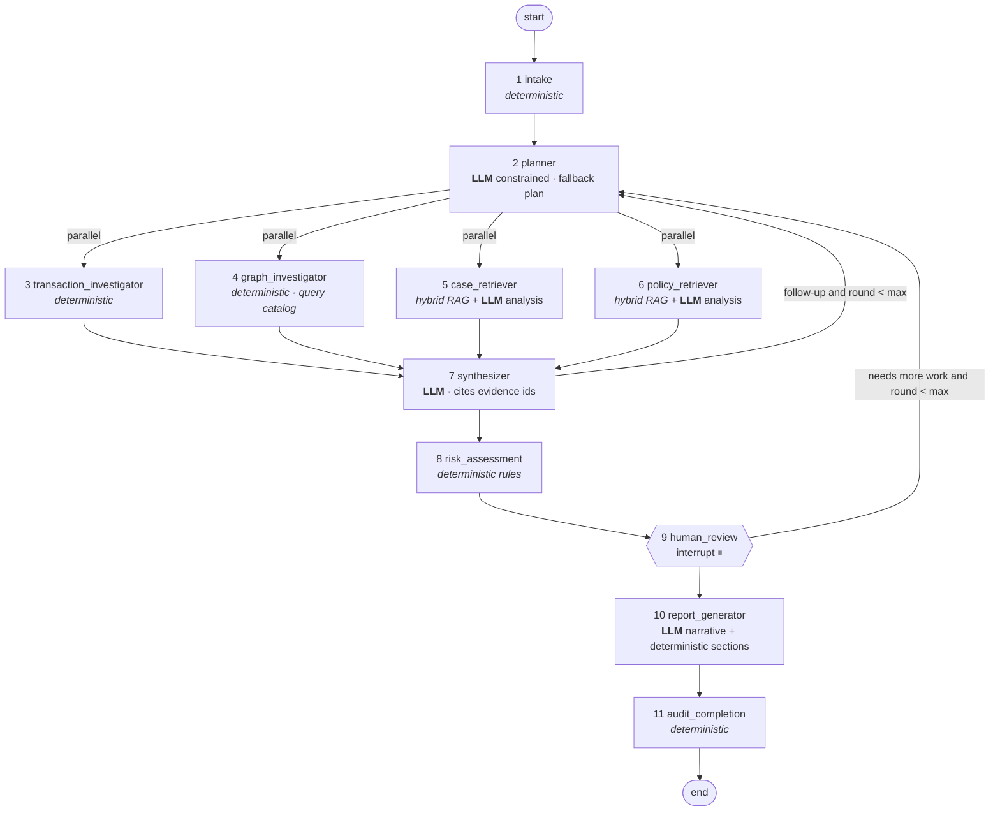
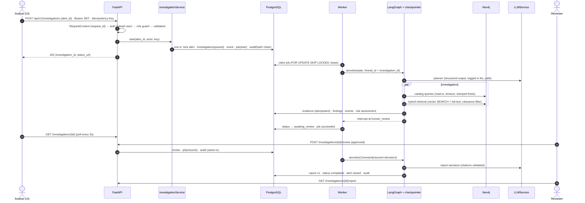

# Architecture: Fraud Ring Investigator


---

## 1. System overview

A **modular monolith** (D-004): one Python codebase and one image, run as `api` and `worker` processes, with PostgreSQL,
Neo4j and a React UI served by nginx.



**The API never runs an investigation.** It writes the investigation, its job and an audit entry in one transaction and returns `202`.
The worker claims the job, runs the LangGraph workflow, and pauses at human review. A review enqueues a resume job.

## 2. Modules

| Module | Responsibility | Depends on | Key decisions |
|---|---|---|---|
| `app/api` | HTTP only: routing, auth dependencies, validation, error envelope, pagination | domain services | D-025, D-045, D-046 |
| `app/domains/identity` | Users, roles, argon2id, JWT, `Actor` | database | D-016, D-045 |
| `app/domains/alerts` | Alert intake (idempotent on `external_ref`) | database, audit | D-046 |
| `app/domains/investigations` | Lifecycle state machine, start, review (four-eyes), timeline, reports, risk rows | database, jobs, audit | D-007, D-030 |
| `app/domains/evidence` | Evidence and findings (idempotent, assertion levels), clearance redaction, network view | database | D-006, D-028, D-033 |
| `app/domains/analysis` | **Deterministic** investigators: transactions, network discovery, retrieval-as-evidence; signals | graph port, RAG | D-029, D-031, D-040 |
| `app/domains/risk` | **Deterministic** versioned rules (`config/risk_rules.yaml`) | signals | D-013 |
| `app/domains/documents` | Upload validation and dedupe; ingestion pipeline | storage, chunk store, embedder | D-035, D-037 |
| `app/domains/audit` | Hash-chained append-only audit log and verifier | database | D-016 |
| `app/graph` | `GraphRepository` port, **query catalog**, Neo4j and in-memory implementations, dataset reader, loader, schema | Neo4j driver | D-008, D-018, D-026, D-027 |
| `app/rag` | Chunking, extraction, `ChunkStore` port (Neo4j and in-memory), hybrid search (RRF), LangChain retriever | embedder, Neo4j | D-009, D-034, D-036 |
| `app/agents` | LangGraph state, nodes, workflow, prompts and LLM tasks, runner, checkpointer | domains, LLM service | D-011, D-038–D-043 |
| `app/infrastructure` | Engines and pools, Neo4j client, LLM and embeddings, jobs, storage, logging and tracing | external systems | D-010, D-023, D-047 |
| `workers` | Claim, lease, retry and dead-letter jobs; graceful shutdown | agents, documents | D-007, D-044 |
| `app/evaluation` | Retrieval and end-to-end evaluation suites | everything | D-048 |
| `simulation` | Synthetic bank, attacks, spec scenario, historical cases, documents, alerts, ground truth | — (never imported by `app/` at runtime) | D-001, D-015 |
| `frontend` | Dashboard, alerts, investigation detail (network, timeline, evidence, report), review, documents | REST API | D-049 |

Import direction: `api → domains → (graph | rag | infrastructure)`, `agents → domains`. Nothing imports `api`.
Business rules live in domain services; nodes are thin; SQL lives in repositories.

## 3. Data ownership (D-005)

| Data | Owner |
|---|---|
| Users, roles, alerts, investigations, status history, node events, jobs, evidence, findings, risk assessments, reviews, reports, audit log, document metadata, LLM call log | **PostgreSQL** |
| LangGraph checkpoints (`checkpoints*` tables, outside Alembic, D-042) | **PostgreSQL** |
| Customers, accounts, transactions, devices, IPs, beneficiaries, merchants, historical fraud cases, investigation mirror | **Neo4j** |
| Document chunks, embeddings, vector and full-text indexes | **Neo4j** |
| Uploaded document bytes | **Volume** (content-addressed, D-035) |

Evidence rows **snapshot** the graph values they relied on, so reports stay valid after a graph reload.

### 3.1 PostgreSQL schema (migrations `0001`, `0002`)



Database-enforced invariants (D-024), all integration-tested:
- one active investigation per alert (partial unique index);
- LLM evidence only as a hypothesis (`CHECK`);
- idempotent evidence (`UNIQUE(investigation_id, content_hash)`);
- an append-only audit log (trigger);
- optimistic locking on investigations;
- job-target integrity (`CHECK`).

### 3.2 Neo4j model (D-018)

```
(:Customer {customer_id, kind, city, address_key, created_at})-[:OWNS]->(:Account {account_id, type, opened_at})
(:Account)-[:SENT]->(:Transaction {txn_id, ts, amount, channel, status})-[:RECEIVED_BY]->(:Account)
(:Transaction)-[:AT]->(:Merchant) · -[:VIA_DEVICE]->(:Device) · -[:FROM_IP]->(:IPAddress {ip, kind})
(:Customer)-[:USES {first_seen, last_seen, observations, source_ref, confidence, verification_status}]->(:Device)
(:Customer)-[:LOGGED_IN_FROM {first_seen, last_seen, observations, failed, source_ref}]->(:IPAddress)
(:Device)-[:ACCESSED_FROM {first_seen, last_seen, observations}]->(:IPAddress)
(:Account)-[:ADDED {ts, device_id, ip, source}]->(:Beneficiary)-[:LINKED_TO]->(:Account)
(:Account)-[:PAID {count, total, first_ts, last_ts}]->(:Account)                derived (D-002)
(:Account)-[:INVOLVED_IN {role, verification_status}]->(:FraudCase {case_id, typology, status})
(:Investigation)-[:INVESTIGATES]->(:Account)                                    mirror, best effort
(:Document)-[:HAS_CHUNK]->(:Chunk {text, embedding, classification_rank, doc_group, page, section})
(:Chunk)-[:MENTIONS]->(:FraudCase | :Account)
```

There are 11 uniqueness constraints, 4 range indexes, a full-text index (`chunk_text`) and a filterable vector index (`chunk_embedding`).
They're applied by `python -m app.graph.schema.bootstrap`.

## 4. Evidence model (D-006, D-031)

| Level | Produced by | Example |
|---|---|---|
| `verified_fact` | Transactions, account profile, alert, document passages | "T00071 moved INR 48,500 A→B" |
| `observed_relationship` | Graph: shared device or IP, beneficiary, money flow | "Device D9 used by 4 customers" |
| `inferred_pattern` | Rules: pass-through, structuring, beneficiary cluster, cycle, card testing | "92% forwarded within 6h" |
| `hypothesis` | LLM only (database `CHECK`) | "Consistent with a layered mule network" |
| `confirmed_outcome` | Human review; closed historical cases | "Reviewer approved escalation" · "FC-2025-1001 confirmed fraud" |

Benign context (`same_household`, `shared_infrastructure`, cleared cases) is **recorded as evidence and shown as a contradiction, but never weighted as risk**.
Risk signals only count links touching the subject or its explicitly registered beneficiaries (D-040).

## 5. Investigation workflow (as built, D-011)



| Node | Type | On failure (D-041) |
|---|---|---|
| intake, risk_assessment, audit_completion | deterministic | job fails → retry from checkpoint |
| planner | LLM (enum ops; mandatory ops added) | deterministic plan |
| transaction, graph, case and policy investigators | deterministic, plus an LLM interpretation for case and policy | 3 attempts → degrade (error and missing-info note); LLM failure keeps the evidence |
| synthesizer, report_generator | LLM | job fails → retry from checkpoint |
| human_review | `interrupt()` | resumable by any worker |

**State** (`app/agents/state.py`) carries ids, refs and small summaries only. Evidence bodies, documents and transactions stay in the databases.
Parallel branches merge through reducers (append, union, merge by key).

## 6. Request lifecycle (as built)



## 7. Security model

- **Authentication:** OAuth2 password flow returns an HS256 JWT (30 min). The user is reloaded on every request (D-045). Passwords use argon2id.
- **Authorization:** roles `analyst`, `reviewer`, `auditor` and `admin`. Route guards are backed by service checks. Four-eyes review (D-030).
- **Clearance:** `public < internal < confidential < restricted`. Retrieval filters inside the index, uploads are capped at the uploader's clearance, and evidence is redacted for lower-clearance viewers (D-033).
- **Database access:**
  - Graph reads only go through catalog queries in read transactions with server-side timeouts.
  - No LLM-generated Cypher runs (D-008).
  - Lucene query escaping is applied to keyword search.
  - Neo4j Community has no RBAC, which is documented (spec challenge 1).
- **Inputs:**
  - Pydantic schemas use `extra="forbid"` and patterns.
  - Uploads are sniffed by content (PDF magic bytes, UTF-8, no NUL bytes), bounded reads are enforced, and storage paths are traversal-safe.
  - Validation errors never echo the input back.
- **Secrets:** there are no defaults in code, `SecretStr` is used throughout, prod rejects weak secrets, and logs are redacted by key (D-023).
- **Audit:** append-only (trigger), with a SHA-256 hash chain and `GET /api/v1/audit/verify`.
- **Frontend:** the token is kept in `sessionStorage`, served same-origin through nginx (no CORS) with CSP, `X-Frame-Options` and `nosniff`.

## 8. Observability (D-047, D-051, D-052)

| Signal | Where |
|---|---|
| Structured JSON logs with `request_id`, `investigation_id`, `job_id`, `node`, `trace_id` | stdout (structlog) |
| HTTP, node and LLM spans | OpenTelemetry → OTLP (Jaeger profile) |
| Metrics: HTTP RED by route template, investigations, node durations, jobs and queue, LLM calls and tokens, retrieval and graph latency, risk mix | `GET /metrics` (API) and `:9101/metrics` (worker) → Prometheus |
| SLIs, burn-rate alerts, symptom alerts | `docker/prometheus/rules/slo.rules.yml` (unit tests in `slo.rules.test.yml`) |
| Dashboard | Grafana, provisioned from `docker/grafana/` and generated by `scripts/build_dashboard.py` |
| LLM latency, tokens, status per task (per call, queryable) | `llm_calls` table |
| Node status and durations per investigation | `investigation_events` → `GET /timeline`, UI timeline |
| Liveness / readiness | `/api/v1/health`, `/api/v1/health/ready` (concurrent pings with timeouts) |

**SLOs** (`docs/SLO.md`):
- API availability: 99.5%.
- GET under 250 ms: 95%.
- Investigation ready for review within 5 minutes: 95%.

**Alerting:**
- Pages use multi-window burn rates. Causes (queue age, dead jobs, LLM errors, graph latency) raise tickets.
- Every metric label is a bounded set. No identifier is ever a label value.

## 9. Deployment (Docker Compose)

| Service | Profile | Role |
|---|---|---|
| `postgres` (17), `neo4j` (2026.09.0 community) | default | databases (named volumes) |
| `migrate` | default, one-shot | Alembic → LangGraph checkpoint tables → Neo4j constraints and indexes |
| `api`, `worker` | default | same image, different command; non-root; healthcheck on api |
| `frontend` | default | nginx serving the SPA and proxying `/api` → `api:8000` |
| `seed` | `seed` | simulate bank → documents → users, graph, documents, alerts (idempotent) |
| `neo4j-test`, `tests` | `test` | isolated Neo4j (wiped by contract tests) plus the dev image running the whole suite |
| `jaeger` | `observability` | trace UI on :16686 (set `OTEL_EXPORTER_OTLP_ENDPOINT=http://jaeger:4318`) |
| `prometheus`, `grafana` | `observability` | scrapes `api:8000/metrics` and `worker:9101`, evaluates SLO rules (:9090); dashboards (:3001) |

Dockerfile stages: `builder` (uv, `--frozen`), `dev` (adds dev dependencies and tests), `runtime` (slim, non-root, `config/` packaged in the wheel).

### 9.1 Delivery pipeline (D-053, D-054)

```
PR / push ─► static ──┬─► evaluation (dev, held-out: blocking · scale: report only) ─► quality gate
             test ────┤   (real Postgres 17 + Neo4j 2026.09, no skips allowed)
             frontend │
             observability (promtool check + rule tests)
                      └─► image (build, Trivy, non-root) ─┐
             test ────────────────────────────────────────┴─► compose-smoke (real stack, seeded, scripts/smoke_test.py)
tag v*.*.* ─► release: app + frontend images → GHCR with SBOM, provenance and attestation
```

**The quality gate** (`config/quality_gates.yaml`, `python -m app.evaluation.gate`):
- **Regression floors** for detection, ring discovery, retrieval and evidence completeness.
- **Hard invariants:** citation correctness is 1, unsupported claims are 0, every alert completes, and every crash recovers.
- **It fails closed.** A missing metric fails the gate.

## 10. Module guide

For every major module: what it does, how it runs, how it fails, and how it's tested.

**API (`app/api`).** Thin routers turn HTTP into service calls. Exceptions map to `{"error": {code, message, request_id, details}}`.
Failures: 401 for a bad or expired token or an inactive user; 403 for a role, four-eyes or clearance violation; 404 if missing; 409 for a state conflict;
422 for validation (input never echoed); 503 when readiness fails. Tests: `tests/unit/app/test_api_health.py`, `tests/e2e/test_api_flow.py` (whole lifecycle over HTTP).

**Investigation domain (`app/domains/investigations`).** The state machine in `state_machine.py`, with every transition writing status history.
`start` serialises concurrent starts by locking the alert row. Review enforces four-eyes and one-review-per-cycle. Tests: `tests/integration/test_domain_services.py`.

**Analysis (`app/domains/analysis`).** Pure deterministic functions over the `GraphRepository` port. They return evidence plus signals.
Benign context is evidence only. Tests: `tests/unit/analysis` (spec scenario, household, carrier NAT, unknown account).

**Risk (`app/domains/risk`).** A YAML ruleset with thresholds, per-unit growth, caps and mitigations with `unless` conditions. It's deterministic and versioned.
Tests: `tests/unit/analysis/test_risk_engine.py`.

**Graph (`app/graph`).** The catalog (`queries.py`) holds parameterised statements, with variable-length depth chosen from a whitelist of pre-built statements.
`Neo4jGraphRepository` runs reads through `Neo4jClient.read`. `InMemoryGraphRepository` mirrors the semantics.
Failures: driver errors propagate, and investigators retry then degrade. Tests: `tests/contract/test_graph_repository_contract.py`, the same assertions for both backends.

**RAG (`app/rag`, `app/domains/documents`).** Upload → validate → store → metadata and job → worker extracts, chunks, embeds and replaces the document's chunks →
status `indexed` or `failed`. Search runs vector and keyword retrieval in parallel lists, fused with RRF, and returns `Citation`s.
Tests: `tests/unit/rag`, `tests/contract/test_chunk_store_contract.py`, `tests/integration/test_documents.py`, plus the retrieval-quality floor test.

**Agents (`app/agents`).** `workflow.py` builds the graph from instrumented nodes. `runner.py` decides between start, continue-from-checkpoint and resume,
and sets `awaiting_review` when interrupted. `prompts/tasks.py` holds the LLM tasks (schema, prompt, validator, fake).
Tests: `tests/e2e/test_investigation_workflow.py` covers the spec example (critical), the household look-alike (low), crash recovery without duplicate evidence, and the needs-more-work loop.

**Worker (`workers/main.py`).** A claim loop with a concurrency limit, renewable leases, failure with backoff, dead-letter that fails the investigation and records an audit entry, and a reaper.
SIGTERM drains running jobs. Tests: job claim, lease and backoff in `test_domain_services.py`; graceful stop in `test_health_and_worker.py`; recovery in e2e and the evaluation.

**Frontend (`frontend/`).** Typed API client; polling while running; every citation chip opens the exact evidence record (snapshot and source ref).
The network view is built from evidence, colours edges by assertion level, and hides benign context behind a toggle.
Verified: `tsc --strict` and the production build pass, plus a headless-Chrome flow (analyst starts → awaiting review → reviewer approves → report) with screenshots in `docs/screenshots/`.

## 11. Testing boundary and how to verify the rest

| Layer | Here | Your machine |
|---|---|---|
| Unit, contract (memory), integration (Postgres), e2e (memory graph + fake LLM), HTTP flow | ✅ 103 passed | `make test` |
| Contract tests against Neo4j (graph catalog, chunk store, vector `SEARCH`) | ⏭ skipped (no Neo4j) | `docker compose --profile test run --rm --build tests`; CI `test` job (skips fail the build) |
| `docker compose up`, image builds, nginx proxy | not verified (registry blocked) | `make up && make seed && make smoke`; CI `compose-smoke` job |
| Evaluation + quality gate | ✅ dev and held-out reproduced exactly, gate passes | `make eval && make gate`; CI `evaluation` job |
| Prometheus rules, alerts, dashboard queries | ✅ promtool tests; live Prometheus against a local API and worker | `docker compose --profile observability up -d`; CI `observability` job |
| Grafana rendering | not verified (no image) | open http://localhost:3001 |
| OpenAI provider (structured output, embeddings) | not verified (no key) | set `LLM_PROVIDER=openai` + key and models in `.env`; `make eval` |

## 12. Repository structure (actual)

```
app/
  api/ (deps, errors, v1/{health,auth,alerts,investigations,documents,audit})
  core/ (settings, enums, errors, pagination, container)
  domains/ alerts · analysis · audit · documents · evidence · identity · investigations · reports · reviews · risk
  graph/ (models, queries, repository, neo4j_repository, memory_repository, dataset, loader, schema/bootstrap)
  rag/ (models, store, ingestion/{extract,chunker,validation}, retrieval/hybrid)
  agents/ (state, deps, instrumentation, workflow, runner, checkpoint, nodes/*, prompts/{schemas,tasks})
  infrastructure/ database · neo4j · llm (service, embeddings, models) · jobs · storage · observability
  evaluation/ (retrieval, investigations, gate) · seed.py · main.py
workers/main.py · migrations/ · config/{risk_rules,quality_gates}.yaml · simulation/ · scripts/{export_openapi,build_dashboard,smoke_test}.py
.github/ workflows/{ci,release}.yml · dependabot.yml        docker/ prometheus/{prometheus.yml,rules/} · grafana/{provisioning,dashboards}/
tests/ unit · contract · integration · e2e        frontend/ (Vite + React + Cytoscape, nginx)
docs/ BACKLOG.md · SLO.md · api/openapi.json · screenshots/  · ARCHITECTURE.md · DECISIONS.md · CLAUDE.md
```

## 13. Known limitations and next steps

1. **Unverified in a live environment:** the Neo4j Cypher (catalog, loader, vector `SEARCH`), Docker builds, and the OpenAI provider. Run §11 before demos.
2. **Optimistic evaluation:** detection numbers come from typologies the rules were designed for (D-048). Next: held-out typologies and an LLM-judge for citation relevance.
3. **No refresh tokens or OIDC.** The JWT is HS256 with a 30-minute lifetime. Production should use an IdP (D-016).
4. **List endpoints use offset pagination.** Switch to keyset pagination for large tables.
5. **The in-memory graph and chunk stores are test doubles only** (D-026). The in-memory chunk store reloads the corpus when a worker starts, but isn't shared across processes.
6. **Ring discovery recall is low (about 0.27):** reports name at most 6 entities. A whole-graph GDS community job is a candidate (D-017).
7. **Detection at ≥ high is scale-sensitive.** On a bank twice the size, recall at ≥ high drops from 0.82 to 0.65 (D-053). CI tracks this as a non-blocking `scale` evaluation.
8. **Metrics are per process.** Multi-process Uvicorn would need `PROMETHEUS_MULTIPROC_DIR`; today the API scales by container (D-051).
