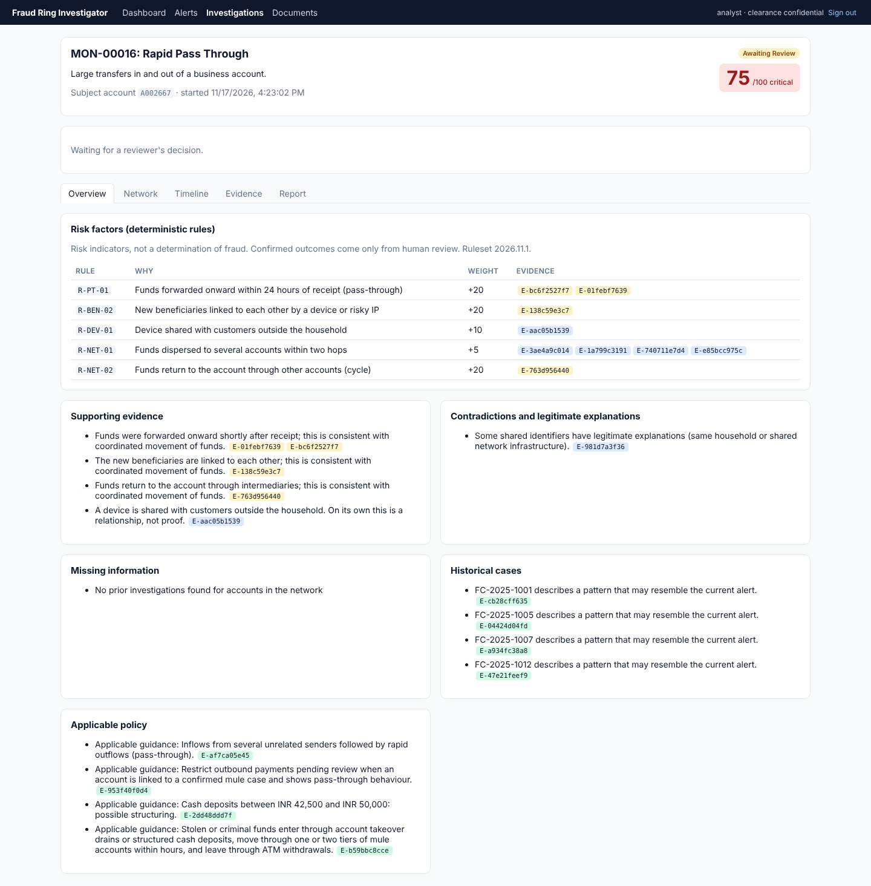
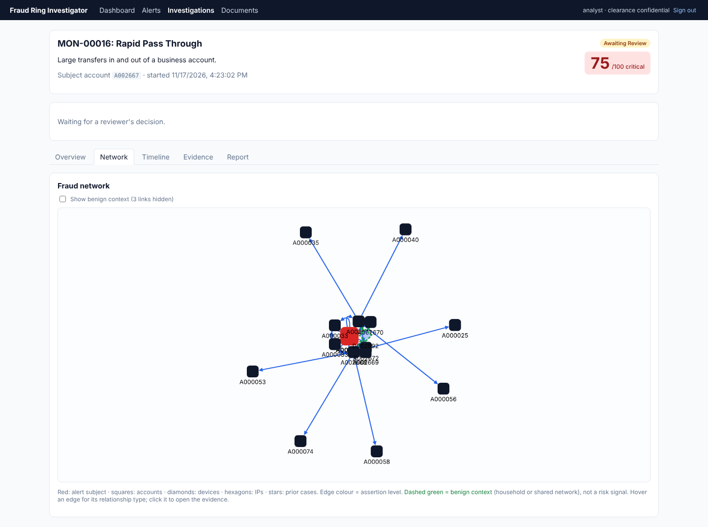
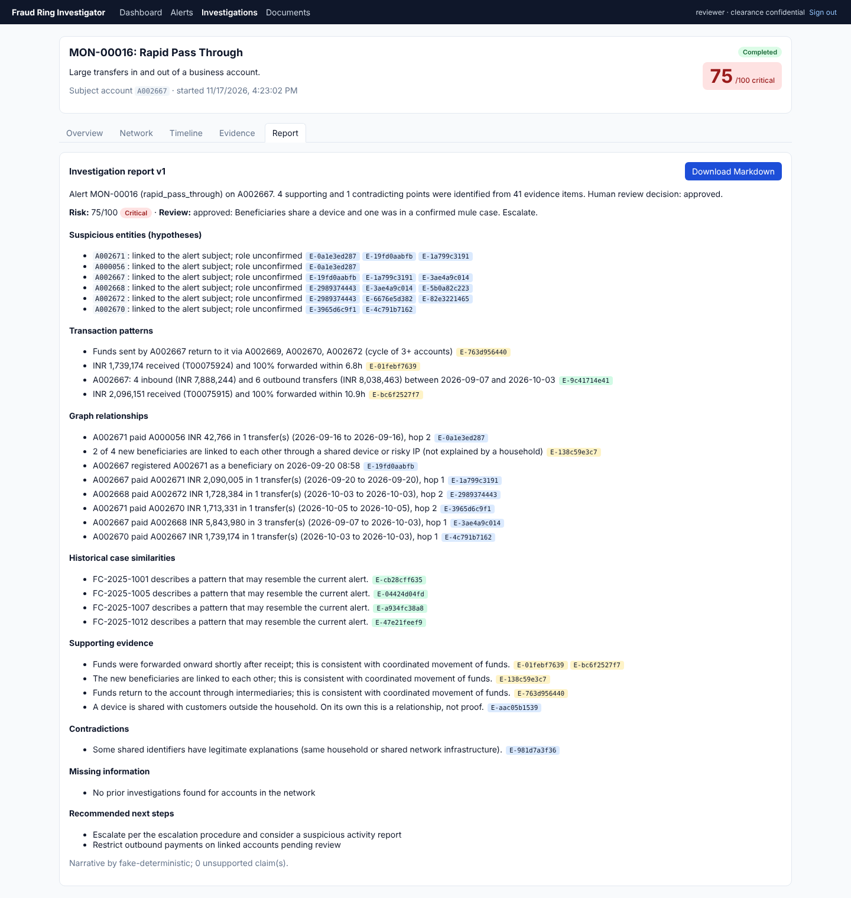
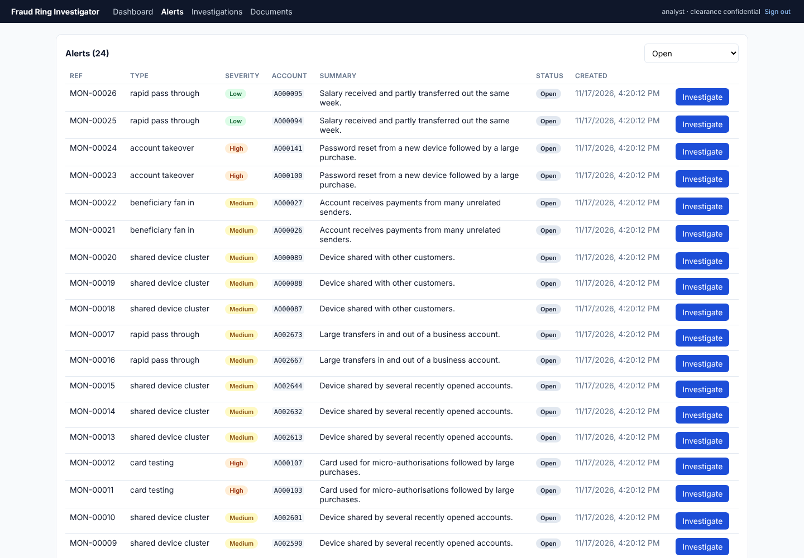
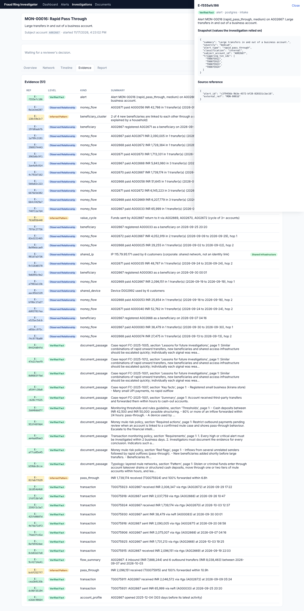
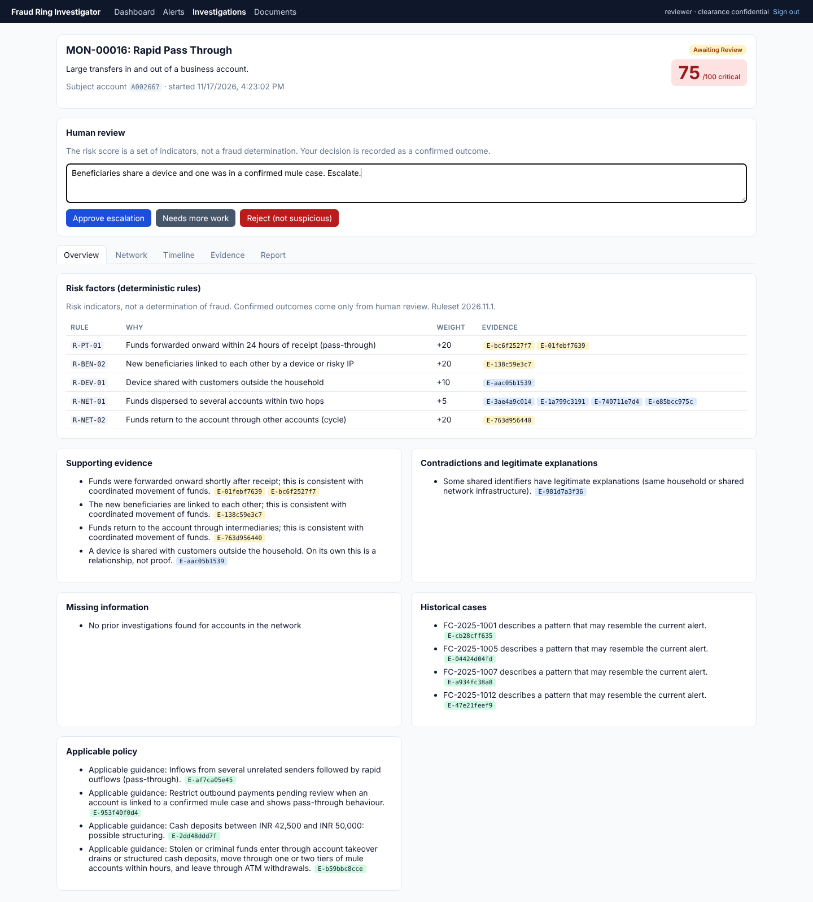
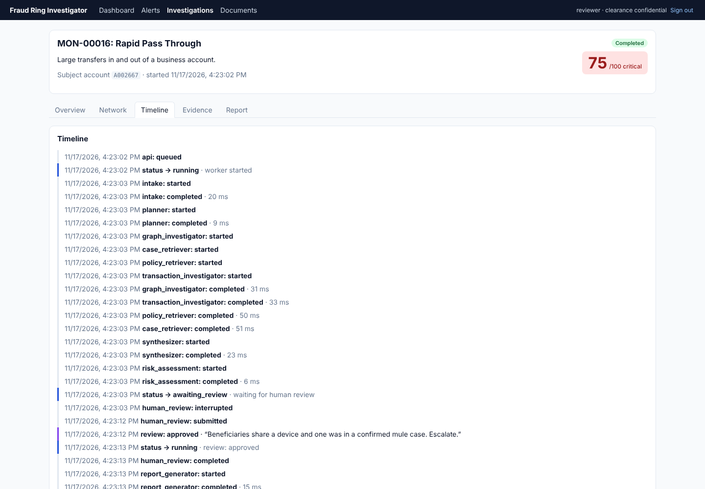
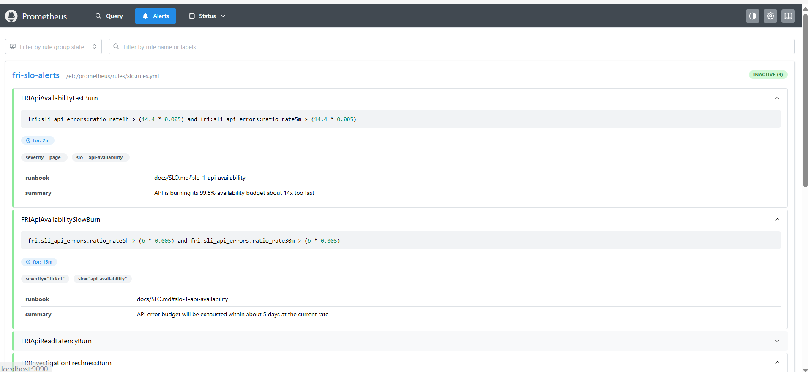
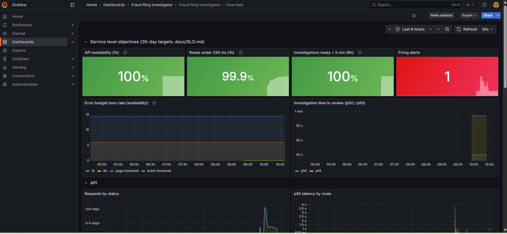
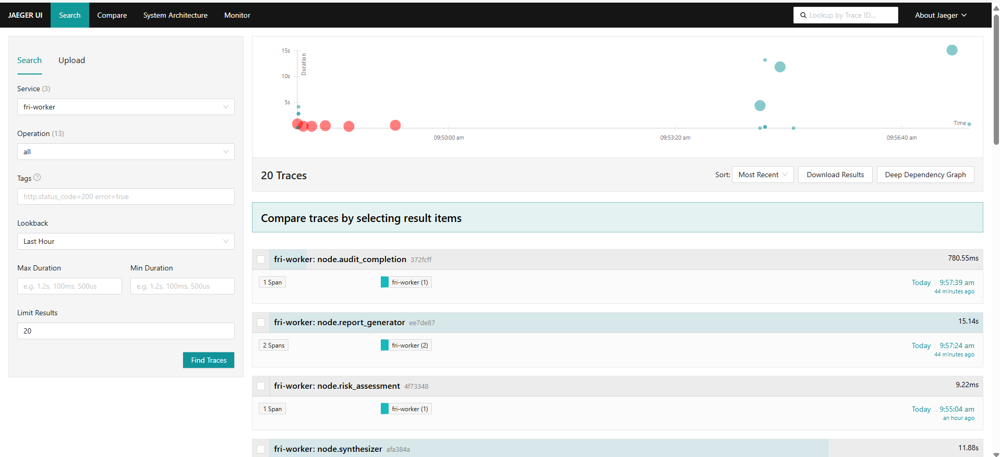

# Fraud Ring Investigator


An AI-assisted platform for investigating coordinated financial fraud. It traces money and identity links through a
graph, retrieves similar historical cases and applicable policy, scores risk with **deterministic** rules, pauses for
**human review**, and writes an **evidence-cited** report.

**Stack:** FastAPI · PostgreSQL (SQLAlchemy 2 async, Alembic) · Neo4j (graph + vector index) · LangGraph (Postgres checkpointer) ·
LangChain + OpenAI · React + Vite + Cytoscape · Docker Compose · OpenTelemetry



---

## Domain context

This project targets three typologies common across payment networks and correspondent banking:

- **Account takeover → mule forwarding** — funds drained from compromised accounts and forwarded through layered mule accounts within hours
- **Structuring (smurfing)** — repeated cash deposits just below reporting thresholds (₹50k in this scenario) to avoid transaction monitoring triggers
- **Synthetic identity clusters** — beneficiaries sharing a device fingerprint or VPN IP, a signal used in network-link analysis before SAR filing

The workflow mirrors how a fraud analyst actually works: triage an alert, traverse the transaction graph, gather and weigh evidence, escalate for four-eyes review, and produce a written finding with cited evidence IDs. The system is built to support — not replace — that analyst.

---

## What makes it different from a chatbot

- **Evidence over eloquence.** Every finding carries one of five assertion levels: verified fact, observed relationship,
  inferred pattern, hypothesis, or confirmed outcome. LLM output can *only* be stored as a hypothesis; a database `CHECK` constraint enforces it.
  Every claim cites evidence IDs that are validated after generation, so fabricated citations are stripped and counted.
- **A shared device is not proof.** Households, carrier NAT, public Wi-Fi, and cleared prior cases are recorded as
  *contradicting* evidence and never add risk (D-031, D-040).
- **The LLM never scores risk.** A versioned YAML ruleset does, and each factor cites its evidence.
- **Production-shaped backend:**
  - **Async, resilient runs:** `202` with polling, a Postgres job queue (`SKIP LOCKED`, leases, exponential backoff, dead-letter), crash-safe resume from LangGraph checkpoints, idempotent evidence writes.
  - **Access control and audit:** JWT with roles, four-eyes review, clearance-filtered retrieval, a hash-chained append-only audit log.
  - **Observability and safety:** OpenTelemetry tracing end-to-end, and no LLM-generated Cypher — ever.

---

## Skills demonstrated

| Competency | Where it shows |
|---|---|
| **Graph analytics on transaction networks** | Neo4j schema, Cypher query catalog, Cytoscape network UI with ring/cluster highlighting |
| **LLMs in a regulated, auditable context** | Five-level assertion model, citation validation, deterministic risk scoring, `CHECK` constraints on LLM output |
| **Production ML quality gates** | `config/quality_gates.yaml`, hard gates on citation correctness and unsupported claim rate, CI eval pipeline |
| **Event-driven, resilient architecture** | Async Postgres job queue, `SKIP LOCKED`, lease timeouts, dead-letter, LangGraph checkpoint resume |
| **Compliance-aware design** | Hash-chained audit log, four-eyes review, clearance-filtered document retrieval, contradicting-evidence model |
| **Observability / SRE** | 3 user-facing SLOs, multi-window burn-rate alerts, Prometheus + Grafana dashboard generated from code, Jaeger traces |
| **Evaluation rigour** | Offline eval over 26 alerts (dev + held-out seeds), regression floors tracked in CI, honest caveats on scope |
| **Secure API design** | JWT auth, role-based access, secrets never in logs, metric labels never contain identifiers (D-051) |

---

## Run it

```bash
docker compose up --build -d                     # postgres, neo4j, migrate, api, worker, frontend
docker compose --profile seed run --rm seed      # synthetic bank + 23 documents + 26 alerts + users
open http://localhost:3000                       # UI · API docs at http://localhost:8000/docs
```

Sign in with `analyst@bank.test` / `ChangeMe-123!`. Open **Alerts** and click **Investigate** on `MON-00001` (the spec scenario).
Then sign in as `reviewer@bank.test` to approve it and read the report. Other users: `analyst2@` (internal clearance), `auditor@`, `admin@`.

No OpenAI key is needed: `LLM_PROVIDER=fake` runs the full workflow with deterministic outputs. For real models, copy `.env.example` to `.env` and set
`LLM_PROVIDER=openai`, `OPENAI_API_KEY`, `OPENAI_CHAT_MODEL`, and `OPENAI_EMBEDDING_MODEL`. Then reseed so documents are embedded by OpenAI.

| More | Command |
|---|---|
| Full test suite in Docker (incl. Neo4j contract tests) | `docker compose --profile test run --rm --build tests` |
| Metrics, SLOs, alerts, traces | `make observe` → Prometheus :9090 · Grafana :3001 · Jaeger :16686. SLOs and runbook: [`docs/SLO.md`](docs/SLO.md) |
| Smoke-test a running stack | `make smoke` (login → investigate → review → report → audit chain → metrics) |
| Local dev | `uv sync && make test` (needs Postgres at `TEST_DATABASE_URL`) · `make ui-dev` |
| Evaluation and release gate | `make eval` writes `reports/evaluation.md`; `make gate` checks it against `config/quality_gates.yaml` |

---

## The spec scenario, end to end

Account A receives several suspicious inflows (account-takeover drains plus cash deposits just under ₹50k). It registers three new
beneficiaries and forwards about 95% of the money to them within hours. The beneficiaries share a device and a VPN IP.
One was in a **confirmed** mule case; another was in an **inconclusive** one.

The investigation finds:
- pass-through and structuring patterns, transfers to new beneficiaries within 24 hours, and a beneficiary cluster linked by device and IP
- the confirmed prior case as evidence, and the inconclusive one reported as a **contradiction** — not involvement
- similar historical cases and the applicable mule policy retrieved from the RAG store
- a score of 100/100 (critical), with eight cited rule factors

The reviewer approves, and the report records the decision as a confirmed outcome.

| Network (benign links hidden by default) | Report with citations |
|---|---|
|  |  |

| Alert triage | Evidence drawer | Four-eyes review | Audit timeline |
|---|---|---|---|
|  |  |  |  | 

| Prometheus View | Grafana View | Jaeger View |
|---|---|---|
|  |  |  |


---

## Evaluation (offline · in-memory graph · fake LLM)

All 26 generated alerts — true and false positives across both seeds — run through the real workflow with a simulated reviewer.
Full reports: [`reports/evaluation.md`](reports/evaluation.md) and [`reports/holdout/evaluation.md`](reports/holdout/evaluation.md).

**Scale:** synthetic bank of 2,000 customers, 45 days, ~12,000 transactions; held-out seed uses stealthier attackers with less obvious clustering.

| Metric | Dev seed | Held-out seed |
|---|---|---|
| Detection P / R (flag at ≥ medium) | 1.00 / 1.00 | 1.00 / 1.00 |
| Detection P / R (flag at ≥ high) | 1.00 / 0.82 | 1.00 / 0.77 |
| Fraud-ring discovery P / R | 0.72 / 0.27 | 0.71 / 0.26 |
| Retrieval Recall@5 / MRR (hybrid) | 1.00 / 0.95 | 1.00 / 0.95 |
| Evidence completeness | 1.00 | 0.97 |
| Citation correctness | 1.00 | 1.00 |
| Unsupported claim rate | 0.00 | 0.00 |
| Workflow recovery (injected failures) | 6 / 6 | 6 / 6 |

**Read these honestly** (D-048): the attack typologies match the rules they were designed for, and the fake LLM measures guardrails rather than model quality. Run with `LLM_PROVIDER=openai` for real model numbers. On a bank twice the size, recall at ≥ high falls to 0.65 (D-053) — tracked as a non-blocking `scale` run in CI.

---

## Production engineering

- **CI** (`.github/workflows/ci.yml`) runs:
  - `ruff` lint, `mypy --strict`, and a check that generated files (dashboard JSON, OpenAPI spec) are current
  - full test suite against **real Postgres and Neo4j**, where any skipped test fails the build (D-054)
  - `promtool` SLO alert tests and the frontend build (`tsc --strict` + production bundle)
  - evaluation quality gate on regenerated dev and held-out data
  - Docker image build with Trivy vulnerability scan
  - `docker compose` smoke test over HTTP
- **Release** (`release.yml`): a version tag pushes images to GHCR with SBOM and provenance. Dependabot keeps dependencies current.
- **Observability** ([`docs/SLO.md`](docs/SLO.md)):
  - three user-facing SLOs (availability, read latency, time to review) with multi-window burn-rate alerts
  - symptom tickets for queue age, dead jobs, LLM errors, and graph latency
  - a Grafana dashboard generated from `scripts/build_dashboard.py` — never edited by hand
  - metric labels that never contain identifiers (D-051)
- **Quality gate** (`config/quality_gates.yaml`): regression floors on detection, retrieval, and grounding, plus **hard invariants** — zero unsupported claims and 100% citation resolution can never be traded away.

---

## Architecture highlights

```
Request lifecycle
─────────────────
POST /investigations/:id/run
  → Postgres job queue (SKIP LOCKED, lease, backoff)
  → Worker picks up → LangGraph agent (checkpointed to Postgres)
        ├── Graph traversal (Neo4j query catalog — no dynamic Cypher)
        ├── RAG retrieval (Neo4j vector + BM25 hybrid, clearance-filtered)
        ├── Risk scoring (versioned YAML rules, deterministic)
        ├── LLM synthesis (hypothesis only, citations validated post-generation)
        └── Human review gate → confirmed outcome written to audit log (hash-chained)
```

- **No business logic in routes or LangGraph nodes.** Domains own their logic; routes own HTTP concerns; nodes own orchestration.
- **No LLM-generated Cypher.** The query catalog (`app/graph/queries`) is the only source of graph queries — read transactions with timeouts and clamped limits.
- **In-memory test doubles** (`InMemoryGraphRepository`, `InMemoryChunkStore`) have behaviour kept identical to Neo4j by contract tests, not special-cased mocks (D-026).

---

## Documentation

- [`ARCHITECTURE.md`](ARCHITECTURE.md) — system overview, data ownership, ER diagram, Neo4j model, workflow, request lifecycle, security, observability, deployment, module guide, testing boundary
- [`DECISIONS.md`](DECISIONS.md) — 54 decision records with alternatives and consequences, including where the original spec was challenged
- [`docs/SLO.md`](docs/SLO.md) — SLO definitions, burn-rate thresholds, runbook
- [`docs/api/openapi.json`](docs/api/openapi.json) (or `/docs` on a running API)
- [`docs/BACKLOG.md`](docs/BACKLOG.md) — phased delivery log
- [`CLAUDE.md`](CLAUDE.md) — working agreement: keep docs current, never claim untested work

---

## What's verified where

| | In this repository | Needs your machine |
|---|---|---|
| 115 Python tests (unit · contract on in-memory stores · Postgres integration · end-to-end workflow · HTTP lifecycle · metrics · quality gate), `ruff`, `mypy --strict` | ✅ | |
| Evaluation reproduced from both seeds; quality gate passes | ✅ | |
| Prometheus against a live API and worker: every SLI and dashboard query evaluated, an alert fired and resolved; `promtool` rule tests; `actionlint` | ✅ | |
| HTTP smoke test against a locally run API and worker | ✅ | `make smoke` against compose |
| Frontend: `tsc --strict`, production build, headless-Chrome analyst → reviewer → report flow | ✅ | |
| Cypher against a live Neo4j (graph catalog, loader, vector `SEARCH`) | | `--profile test` run |
| `docker compose up`, image builds, nginx proxy, Grafana | | `make up && make seed && make smoke`, `make observe` |
| GitHub Actions run (Neo4j service, Trivy, compose smoke) | | push to GitHub |
| OpenAI structured outputs and embeddings | | `LLM_PROVIDER=openai` |

---

## Repository

```
app/         API, domains (alerts, investigations, evidence, analysis, risk, documents, audit, identity),
             graph (query catalog, Neo4j + in-memory), rag, agents (LangGraph), infrastructure, evaluation
workers/     job runner
migrations/  Alembic
config/      risk_rules.yaml · quality_gates.yaml
simulation/  synthetic bank, attack playbooks, spec scenario, historical cases, documents, alerts, ground truth
frontend/    React + Vite + Cytoscape, nginx
tests/       unit · contract · integration · e2e
docker/      Prometheus config + SLO rules, Grafana provisioning
.github/     CI, release, Dependabot
```

All data is synthetic. No real customers, institutions, or regulations are reproduced.
